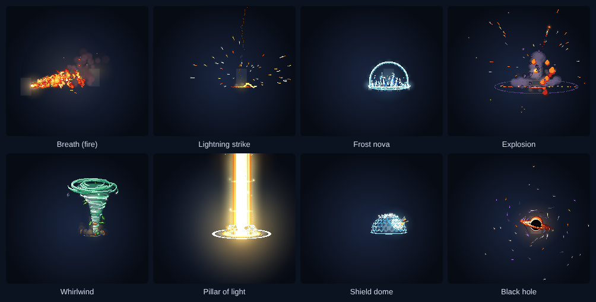
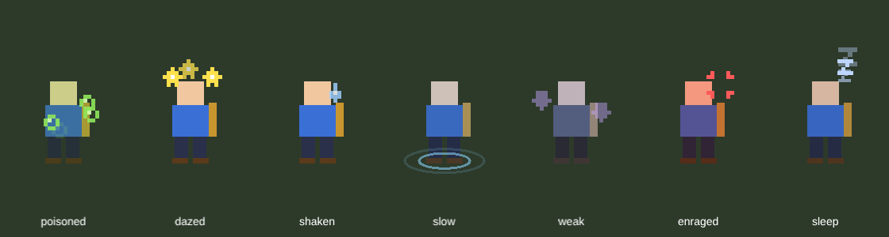
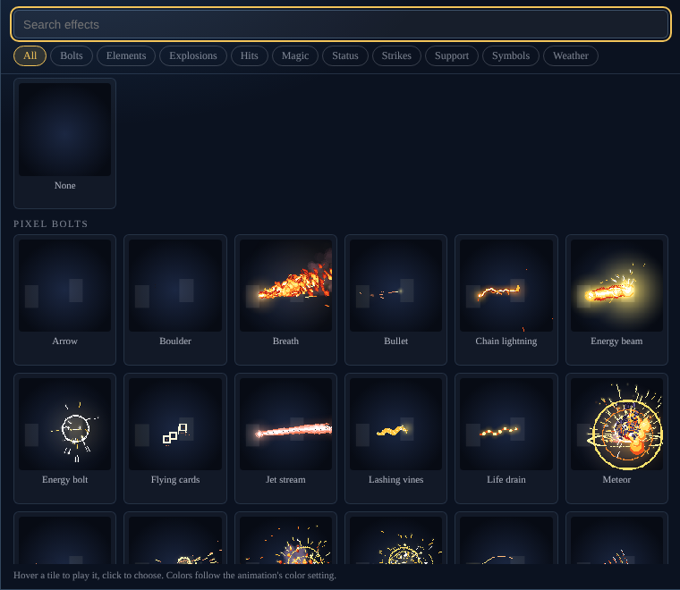

# Fabula Ultima Battle Animations

Animations for Project FU (Foundry v13, Project FU 4.14+). Works on its own, and alongside Fabula Ultima Battle UI.

## Install
In Foundry: **Add-on Modules → Install Module**, paste this Manifest URL and click Install:
`https://raw.githubusercontent.com/EclipseGS27/fu-animations/main/module.json`

Requires Foundry v13 and the Project FU system 4.14 or later. Enable **Fabula Ultima Battle Animations** in your world. The animations need nothing else; for sound, add the sound pack as described under [Assets not included](#assets-not-included). For the JB2A preset, also install the free **JB2A - Free Content** module.

## What plays
- **Every class ability, spell, NPC spell and Core item in the Project FU compendium has an animation** (446 entries), picked to fit: Glacies freezes, Ignis burns, Heal glows green over your allies, Omega drops a death mark, Arcana flare up when summoned, dances, verses, therioforms, magiseeds and symbols each get their own. Passive Skills that never get used in a fight (Fortress, Dodge, Well-Traveled...) have none.
- **Weapons and NPC basic attacks** animate from their category and damage type: swords, daggers and flails slash, heavy weapons and fists smash, spears thrust, bows fire arrows, firearms flash and shoot, thrown weapons fly, magic damage recolors the hit.
- **Every NPC attack and spell in the bestiaries** (611: Core Rulebook, Bestiary vol. 1, Natural, High and Techno Fantasy Atlases). They match by name, so an NPC built with a book attack's name (Claw, Flamebreath, Laser Beams, Yawn...) gets its animation automatically. NPC spells that are player spells (Ignis, Glacies...) use the player animation.
- **Basic actions**: Guard raises a shield dome on the user, Study puts a question mark over the user and an alert on the target (then a light bulb), Hinder throws a curse and binds the target in chains. Change them for the world under **Actions** in the ability list.
- **Homebrew** skills, spells and NPC attacks read their name the same way: "Acid Spit" sprays, "Savage Bite" bites, "Thunder Roar" arcs lightning. Anything the name doesn't explain falls back to its type and damage (setting to turn guesses off).

## Presets: Original or JB2A
Settings → **Animation preset** (GM, whole world):
- **Original (pixel art drawn in code)**: every ability, spell, weapon and bestiary attack as pixel art drawn in code, after Sprite Fusion's open source pixel art VFX library. Needs no asset packs. See below.
- **JB2A (free)**: every ability, spell, weapon and bestiary attack plays JB2A effects instead. Needs the free **JB2A - Free Content** module (JB2A Patreon works too). Swords, axes, maces, daggers and fists swing their JB2A weapon; bows, crossbows, guns, thrown knives, bombs and flasks fly as JB2A projectiles; Ignis throws a fire bolt into an explosion, Glacies a ray of frost, Fulgur chain lightning, breaths become JB2A breath cones, heals, shields, curses, sleep, webs, roots and summon circles use their JB2A versions, and every spell starts on a JB2A rune circle in its element's color. The few effects JB2A has nothing for (meteor showers, petal storms, steals, mocking laughter) play their pixel version.
- Switching back and forth is instant and loses nothing. **Your own changes are universal**: an animation you set on an item, or for the whole world, plays the same in either preset, and the editor lists both libraries (JB2A effects under "JB2A ..." groups, JB2A bolts and beams in the Projectile list), so you can mix them freely.
- The impact layer (freeze, shake, debris, camera, cut-ins, damage numbers) works the same on both. JB2A swings and bolts land their hit on the frame the blade or bolt reaches the target.
- If the preset is JB2A but the JB2A module is off, the Original preset plays and the GM gets a warning.
- Animations saved while the old sprite effects existed still play: anything that names one plays its pixel (or JB2A) counterpart.

## The Original preset: pixel art
All 446 compendium entries and 611 bestiary attacks play in pixel art:
- **From Sprite Fusion's library** (all 25 of their effects, run as they are): slashes, impacts and ricochets, muzzle flashes, blood, dashes and blinks, burning outlines, lightning strikes, chain arcs and electrified bodies, frost novas, ice spikes, crystals, shattering blocks and frozen bodies, toxic clouds, puddles and poisoned bodies, power gathering, energy beams, bolts and orbs, hex shield domes, a black hole, pillars of light and smites, healing crosses and mana drops, power-up auras, gems and coins, sparkles, and rain, snow, fog, embers, fireflies, falling leaves and bubbles.
- **Drawn for this module in the same style**: snapping jaws, an evil eye, insect swarms, sleepy Zs, dizzy stars, laughter, music notes, symbols (alert, question, crown, arrows, skull, heart...), wisps, smoke, webs, chains, rune circles, shockwaves, sound waves, whirlwinds, breath, jets, vines, a life-drain tether, flying cards, and arrow, bullet and boulder projectiles.
- **Combined** for bigger moves: slash combos and cross slashes, claw marks, thrusts, meteors with explosions, falling barrages, rocket salvos, shard volleys, rapid fire, attack/magic/defense up, curses and death marks.
- Each one is recolored by element with its own pixel-art palette (fire, ice, bolt, air, earth, light, dark, poison), so a fire sword swings a fire slash and Fulgur's arc is yellow. Spells start on a rune circle in their element's color; signature spells (Ignis, Glacies, Fulgur, Flare, Comet, Drain Vigor...) are hand-picked.
- Effects draw behind and in front of tokens (shield domes wrap around them, scorch and ground glow sit under them), and flames, frost, poison and electricity follow the token's own image.
- Lightning, pillars of light, meteors, beams and bolts land the hit (freeze, shake, debris, damage) on the frame they reach the target, like the JB2A preset. Critical hits get a heavy pixel impact.
- The whole impact layer, cut-ins, sounds and damage numbers work the same. Pixel effects are listed under "Pixel ..." groups in the editor (with live previews) and in the Projectile list, and can be picked in any preset.
- One art pixel is 1/36 of a grid square at effect size 1; the Effect size setting and big tokens make the pixels bigger.

## How it plays
- It follows the chat card: when a Check or an ability is posted, the animation runs from the speaker's token to the targets on that card (or your current targets when the card has none). Everyone sees it.
- **Melee**: the attacker dashes next to the first target, strikes, and walks back to its spot. Only the picture moves; the token's position never changes.
- **Spells and ranged**: cast effect on the user, a projectile when there is one (magic orb, arrow, bullet, beam, boulder, meteor), then the hit on every target.
- **Misses**: the target sidesteps with a blur and the hit fades.
- **Impact**: every move has an impact level, Light, Normal, Heavy, Heroic or Limit break, which decides how hard it lands:
  - the hit freezes the scene for a split second, the target flashes, sparks, embers or rubble fly off along the blow, the view shakes and the target is knocked back;
  - melee attackers wind up and dash in, leaving afterimages on heavy moves;
  - fire, magic orbs and other projectiles fly as blazing bolts with tails, sized by the impact;
  - heavy spells darken the scene with the fighters spotlit, the caster rises while power gathers, the camera leans in and the ground keeps a scorch mark for a moment;
  - heroic moves open with a full-screen **cut-in** (character portrait and move name), and a **Meteor** projectile falls from the sky onto a warning circle.
  - **Limit break**, one level above Heroic: cinema bars slide in and the scene goes dark, a limit-break cut-in crashes across the screen (white flash, crossing bands, light rays, "ZERO POWER" over the move name), then power gathers on the user (a turning magic circle, a pillar of light, motes spiralling in, focus lines, the user lifting and trembling) while the camera leans in. A white-out, and the move lands at one and a half times its size with rolling shockwaves, an earthquake shake and embers drifting up after. **Zero Powers** play this way on their own, and each of the eleven zero effects from the High Fantasy Atlas has its own scene after the cut-in (which names the effect), drawn with pixel art effects from the [pixelfx](https://github.com/patch-gg/pixelfx) library:
    - **Zero Blitz**: power gathers, then four afterimage dash-strikes from all sides (dagger flurries) and a critical burst.
    - **Zero Chance**: three dice tumble and land at the user's feet (a roll of doubles pays out bigger), fireworks over the user, coins on everyone.
    - **Zero Cost**: a magic circle opens, a treasure chest bursts open in a column of light, coins shower over the party.
    - **Zero Elements**: the power's two elements charge in turn, then strike the targets one after the other; the user keeps the aura.
    - **Zero Limits**: a lightning charge-up, DEX/INS/MIG/WLP badges rise one by one, a power star as the user grows.
    - **Zero Magic**: a spell charges on the user, magic circles fire columns of light up from every target, stars fall on them.
    - **Zero Objective**: a clock face springs open, ticks slower and slower, freezes and shatters.
    - **Zero Remedy**: holy pillars on every ally, healing rings, a burst of feathers.
    - **Zero Scourge**: storm clouds over the targets, a hex sigil on each, their element strikes all at once, curses linger.
    - **Zero Shield**: a divine shield on the user, then a force-field dome over every ally.
    - **Zero Triangle**: seals bloom at the feet of the user and two allies and light links them into a triangle, then three arcane beams converge on the target.
    Players name their own powers, so the effect is read from the power's Zero effect field, then its text, then its name.
  - **Editing a Zero Power**: the editor shows a **Limit break** section for Zero Powers (and anything set to Limit break): the scene (Automatic, any of the eleven, or the general limit break), a color (the scene's own palettes or any custom color, which recolors all of it), and the scene's three stages, **charge**, **main** and **finish**, as live previews. Click a stage to pick any effect for it from the grid (or None); ↺ puts back the scene's own. The scene keeps its motion and timing; Size and the Impact settings (cut-in title, color, portrait) still apply. Any ability can be set to Limit break too.
  - 25 more pixelfx effects (and three new ones made for these scenes: a dice roll, a trinity link and a stat rise) are in the effect grid under **Pixel Limit Break**, for any animation.
  - **Bosses**: champions and villains hit one level harder. They wind up with a red flare and a magic circle at their feet, their biggest moves get a red cut-in ("CHAMPION", or the villain's rank), and red shockwaves roll out where they land. A world setting turns this off.
  - **Boss moves**: a champion's, villain's or elite's (setting "Elites count as bosses", on by default) big moves (spells, skills, heroic and critical hits) play a signature scene instead: **Cataclysm Breath** (floods the targets with its element), **Earthshaker** (leaps and slams, the ground cracks in rings), **Savage Onslaught** (claws and fangs from every side, then a crushing blow), **Calamity Rain** (its element rains down on every target), **Annihilation Ray** (a long charge, then a ray), **Abyssal Grasp** (hex sigils drain the targets), **Call of the Horde** (a summoning circle and pillars of light), **Terrifying Roar** (shockwaves wash over every enemy), **Unbreakable Bastion** (a dome of force as it hardens or recovers) and **Judgment** (pillars of light or lightning). The move is picked from the ability's name and text, then its element and style; change it per item under **Boss move** in the animation editor. A world setting plays them on big moves (default), on every action, or never.
  - Automatic levels: Zero Powers are Limit breaks, Heroic Skills are Heroic, spells on two or more targets are Heavy, attacks and other spells are Normal, support and self effects are Light. **Critical hits go one level up** (a crit sword swing lands like a heavy blow); fumbles drop to Light.
- **Damage numbers**: when damage is applied, the number slams onto the token and bounces: gold and larger after a critical, with the element and the Affinity that applied under it (VULNERABLE in orange, RESISTED in grey-blue, ABSORBED as green healing), IMMUNE when nothing gets through, green for healing. A miss shows MISS as the target dodges. Several numbers on one token stack instead of overlapping. They replace the system's plain "-12 HP" text, and with Fabula Ultima Battle UI installed they replace its numbers too.
- **Drains** (Drain Vigor, Drain Spirit, Soul Steal...) send a heal back to the user.
- **Hover**: while a conflict runs, combatants on the scene bob gently in place. Defeated ones stay still.

- **Conditions on the map**: while a token has a status, a small pixel-art loop plays on it and its sprite is tinted: poisoned bubbles (green), dazed stars circling its head, shaken trembling and a sweat drop, slow ripples at its feet (cold tint), weak sinking arrows (drained), enraged a throbbing anger mark (red), asleep floating Zs. Several tints take turns. Client setting.
- **On the ground**: ground effects (explosions, lightning strikes, ice and rock spikes, pillars of light, puddles, rune glyphs, shield domes, scorch marks, meteor warning circles) start under the figure's feet, read from the token art, instead of halfway up its legs.

## Sound effects
Every animation plays sounds from Helton Yan's Pixel Combat (317 sounds, up to three takes each, picked at random so repeats don't sound identical):
- a sound when the move starts (the cast effect, or the launch for a projectile or a breath, beam, jet...), a whoosh when a melee attacker dashes in, and a sound when it lands;
- misses play a deflect instead of the hit, critical hits add a critical strike;
- elemental spells with a plain hit use their element's sound (fire hit, electric hit, crystal for ice...).
Sounds play on each player's Environment volume channel. Client settings: sound effects on or off, sound effect volume.

## Changing an animation

- **One item**: open the item sheet, header menu → **Animation**. Or right-click it in the Items directory. The choice is stored on that copy of the item, so two characters can animate the same sword differently, and everyone sees each attacker's own choice.
- **An ability for the whole world** (GM): Settings → Ability animations → **Open the list**, search, **Edit**. Bestiary attacks are in the list too, grouped by book. Or save from an item's Animation window with "Every … in this world".
- **A kind of weapon for the whole world** (GM): the list has a **Weapons** group with one entry per category (Swords, Daggers, Bows, Firearms, Heavy weapons, Shields...). What you set there plays for every weapon of that kind that has no animation of its own. A weapon's Animation window can also save "Every sword in this world".
- The editor shows the effects as a row of **live preview cards** (on the user, projectile, on each target, back on the user): click a card to pick its effect from a **grid of every effect** (search, filter by kind, hover a tile to play it, click to choose). Under them: the color (from damage type, original, any element, or a **custom color** from a color picker: it recolors the animation in every preset, the free JB2A effects included, by turning them to that hue, saturation and lightness), the size, and the **sound on use** and **sound on hit** (Automatic, Silent, or any of the 317 sounds, with a play button). The impact settings are folded under **Impact** until you want them. **Try on the scene** plays it from your selected token at your targets, only for you. **Reset** goes back to the built-in choice.
- The editor and picker load fast: JB2A clips are loaded once and reused while you change things, JB2A tiles in the picker get a still frame (a few at a time, in the background), and every still is kept, so the picker opens instantly the second time.
- The **Impact** section sets the level and each part of it on its own: freeze on hit (none to very long), screen shake (none to earthquake), camera push, darkening, wind-up and afterimages (melee), debris (sparks, embers, rubble, mixed or none), the mark on the ground, and the cut-in. Every choice starts on Automatic, which shows what it does for that ability. With the cut-in on you can set its title, color and portrait (the character art by default) and preview it. **As a critical** next to Preview plays the critical version.
- Priority: the item's own choice, then the world choice for that ability, then the world choice for that kind of weapon, then the built-in table, then the guess.

## Settings
Client (each player for themselves): play animations, hover during conflicts, hover height, show conditions on tokens, effect size, sound effects, sound volume, freeze frame on hits, screen shake, camera push, darkening, cut-ins, battle damage numbers. Turning one off wins over every ability's choice, for that player only.
World: melee attacks dash to the target, animate homebrew abilities, the ability list.

## Credits
- Pixel Combat sound effects - Helton Yan
- JB2A preset: plays effects from JB2A - Jules and Ben's Animated Assets (not included; install their module)
- pixelfx (https://github.com/patch-gg/pixelfx), MIT License, Copyright (c) 2026 Patch and Hugo Duprez: breath, jet stream, whirlwind, spirit wisps, smoke puff and the 25 Pixel Limit Break effects used by the Zero Power scenes, plus three made for them with its method (dice roll, trinity link, stat rise). Included in `scripts/pfx/` with the license next to it.
- Original preset: Sprite Fusion's open source pixel art VFX (https://www.spritefusion.com/pixel-art-vfx), MIT License, Copyright (c) 2026 Hugo Duprez. Included in `scripts/sf/` (converted to JavaScript), with the license next to them.

The sound pack forbids redistributing its files. Keep this module private while the sfx folder is inside it.

## Assets not included
This repository holds the code only. The sounds are a paid pack whose license doesn't allow redistribution. To run the module with sound, buy it and place it as:
- `sfx/`: Helton Yan's Pixel Combat sounds as `.ogg`, with the file names listed in `scripts/sounds.mjs`

The animations need nothing else: the Original preset is all code, and the JB2A preset needs only the free "JB2A - Free Content" Foundry module.
